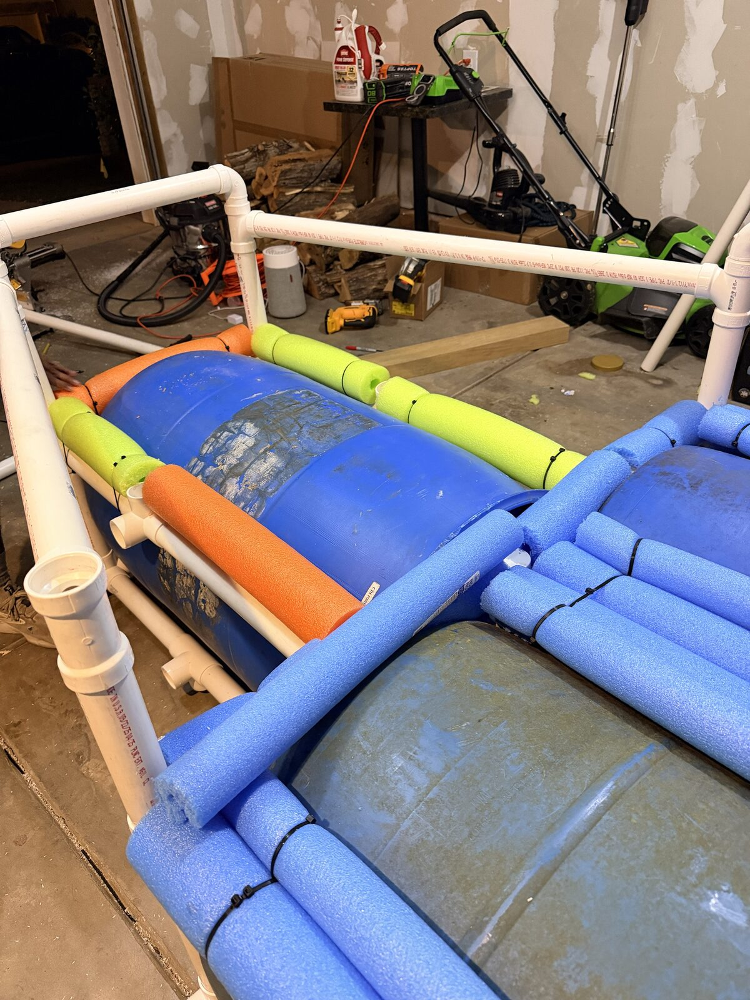
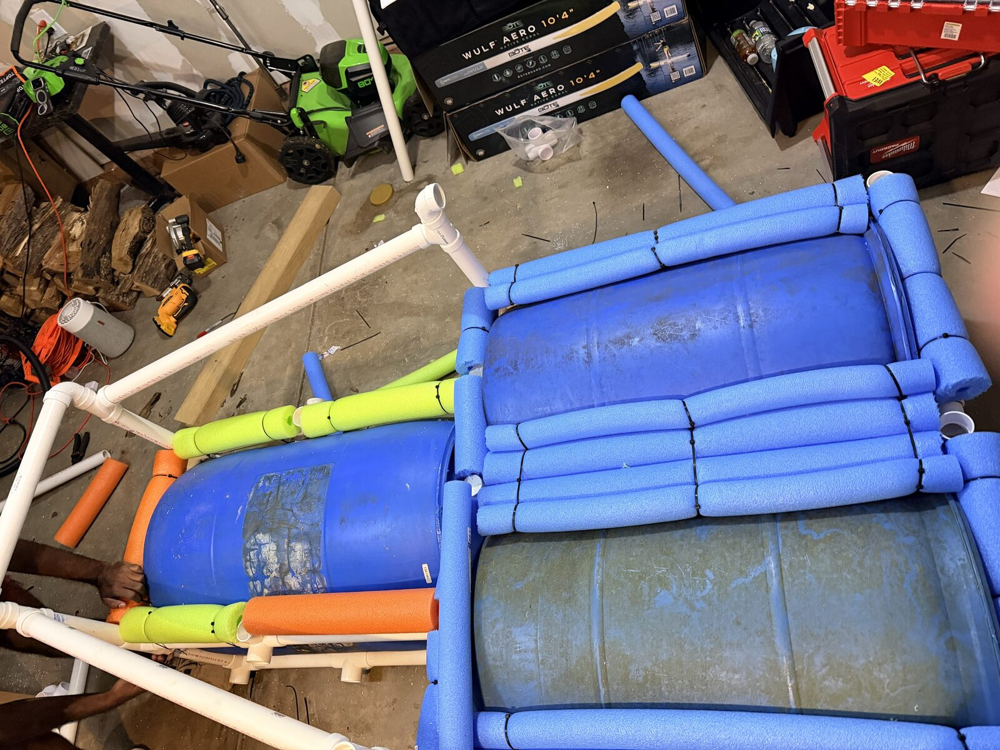
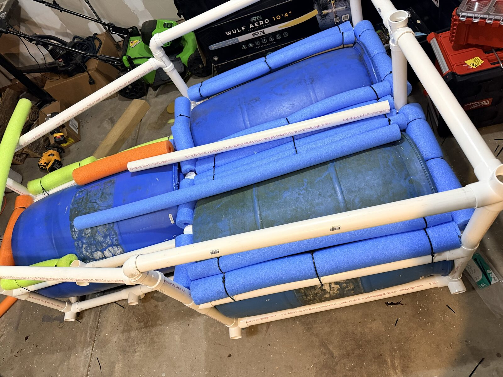
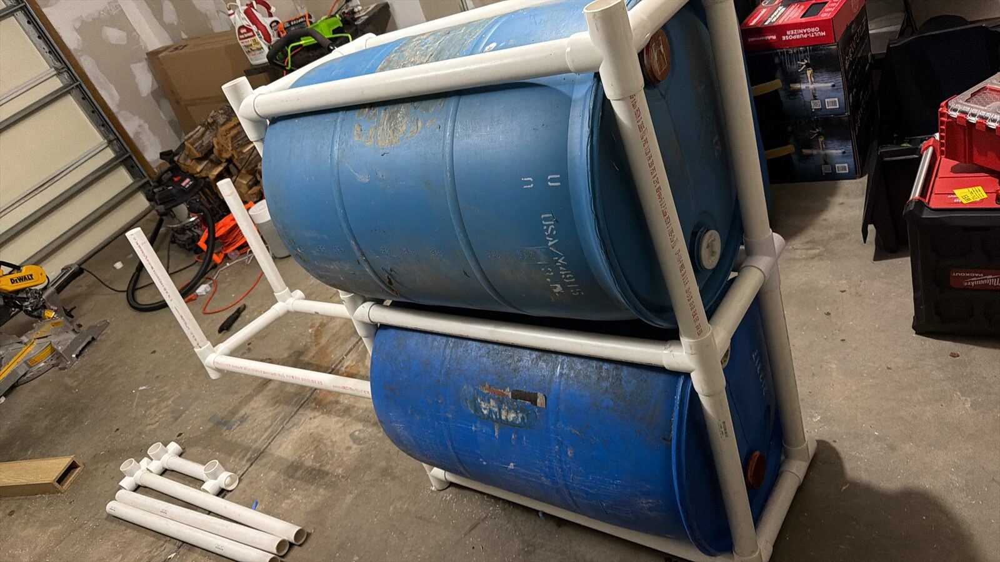
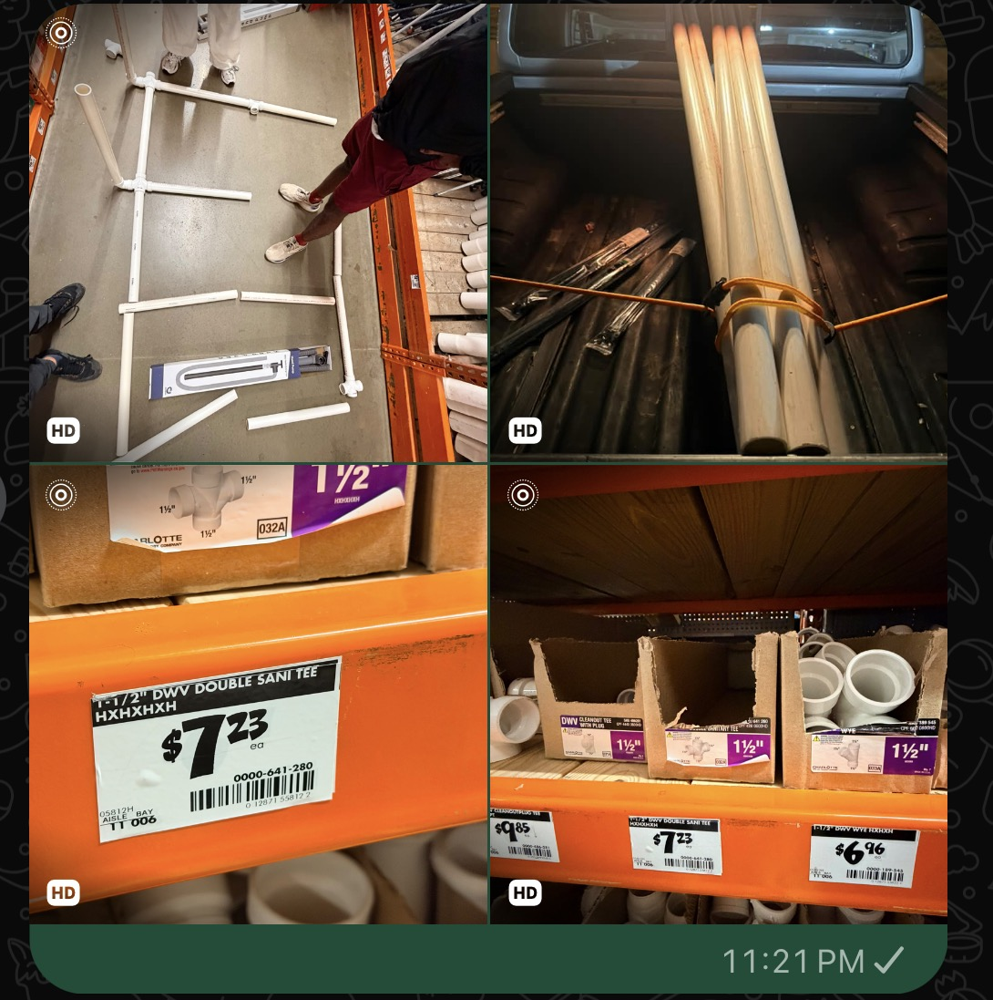
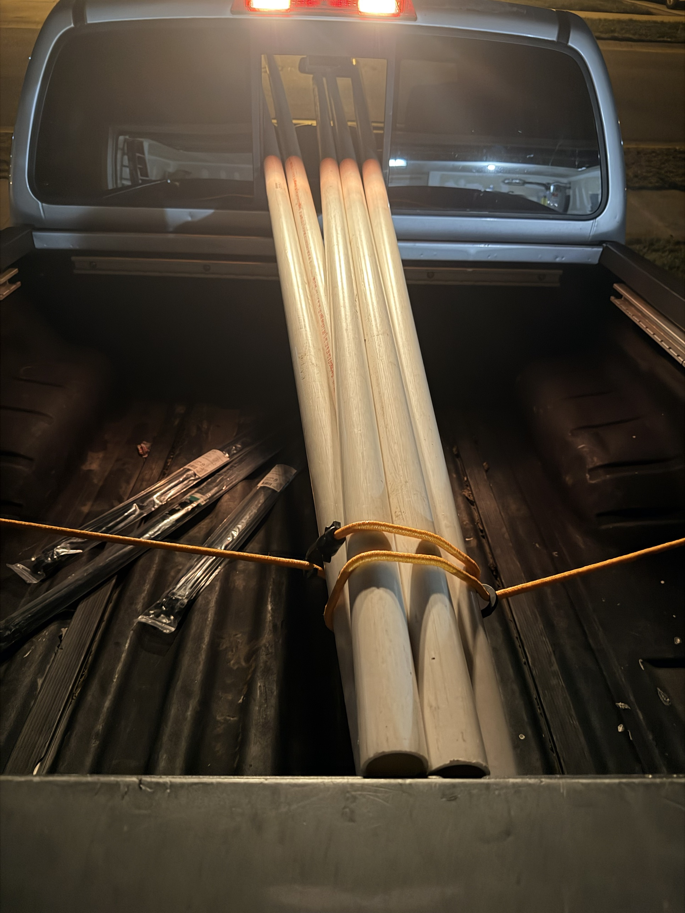

# Design Notes: Pirate Drum Raft

**Status:** the current plan (2026-10-03) is the **packed triangle in box
frames**.
- Two drums sit side by side at the stern and one sits in front of them on
  the centerline.
- Every drum is boxed in 1-1/2" PVC: top and bottom rectangles and corner
  posts.
- This is the default in `data/build.json`. The other 2–4 drum layouts are
  still in the simulator for comparison. Use
[`raft-simulation.html`](../raft-simulation.html) to try configurations; this
doc records the reasoning and the findings so far.

## Sources of truth

| What | Where | Notes |
|------|-------|-------|
| Actual build (configuration + parts) | `data/build.json` | Edited in the simulator's Parts tab, exported and committed |
| Suggested materials | `data/catalog.json` | From the *Boat Building Shopping List Comparison* sheet (2026-09-29), plus rule-driven additions (foam fill, fittings, floating rope). **Suggestions, not commitments.** |
| Rules | `data/rules.json` | From the [official page](https://whitewater.org/race/build-your-own-boat-competition/) via search excerpts; that site is blocked from the dev environment. **Check them against the official page.** |
| Geometry and physics | `scripts/raft-model.js` | Shared by the simulator, the report and the tests |
| Original render | `raft-render.html` | 4-drum lightweight raft that the frame geometry comes from |

## Event

- **Sat Oct 10, 2026**, competition 12–4 PM, Class II–IV channel, U.S.
  National Whitewater Center.
- Teams of 1–4, 16+, $60. Scored on **style and performance**.
- The venue provides paddles, PFDs and helmets.

## Rules and how the design meets them

| Rule | Approach |
|------|----------|
| < 150 lb | Weight is computed from the parts list. Weigh parts and tick "measured" |
| ≤ 10 × 10 × 5 ft | Checked from the geometry, including the bow and mast |
| Walls < 2 ft | Checked: bow guard and noodle rail are ~8" |
| No metal | Name and material scan of the parts list |
| All materials float, even broken | Foam-fill every PVC pipe and fitting (filled 1-1/2" pipe averages SG ~0.4). Flags nylon paracord, canvas and cushions for a bucket test |
| Wood ≤ 1/4" | Checked from `thickness_in`; the 1" dowel mast was replaced by a PVC offcut |
| Rope/straps ≤ 18" | Checked from `max_piece_length_in`. Drums are held by **daisy-chained 17" zip ties**; **confirm with the organizers** |
| Zip ties trimmed flush | Flush-cut snips on the list |

## Team progress

### 2026-10-07: pool noodles and railings

- **Pool noodles on the frame:**
  - **Rear pair:** the box rails are wrapped in blue noodles, zip-tied in
    bundles. They're doubled and tripled along the shared middle wall
    between drums D2 and D3, and run along the outer rails and ends.
  - **Bow box:** green and orange noodles line its side and end rails.
  - The noodles add flotation and padding, and cover the pipe and fitting
    edges.
- **Railings:** a raised PVC railing frame is going up on the bow box. Tall
  corner posts carry long top rails that run aft over the drums.
- **Fittings:** side-outlet tees on the bow box's lower rails have open
  sockets for the next pieces.
- **To check against the rules:**
  - **Walls under 2 ft:** measured from the deck (interior floor) to the top
    of the railing.
  - **Overall height:** 5 ft maximum.
  - **Weight:** 150 lb maximum; the railing pipe adds weight.
  - Measure the railing height once the deck is on.

- **Now in the default model** (Configure → Railing, plus two sliders):
  - **Railing:** a post at each outer box corner, with top rails around the
    outline of all the boxes. The rails angle in from the wide rear pair to
    the narrow bow box: 6 posts, 6 top rails, labelled P… in 🏷️ IDs and on the
    cut list.
  - **Noodles on the box rails:** 2 layers along every fore-aft top rail, on
    both faces of the shared middle wall. They count toward the noodle total,
    weight and emergency foam lift.
- **Estimated, please measure:**
  - **Railing height:** 10" above the box tops, guessed from the photo. That
    puts the wall about 8" above the deck, well under the 2 ft rule.
  - **Noodle layers:** 2.
- **What it changes:**
  - **Weight:** predicted ~145 lb, close to the 150 lb limit.
  - **Pipe:** 11 sticks with the 0.5" cut allowance; 7 are on hand.
  - **Roll stability:** GM is about 2.6" with this setup.

### 2026-10-06: glue-up progress

- **Glued so far:**
  - **Rear pair:** the two side-by-side drum boxes are glued up with drums D2
    and D3 inside. They share the middle wall, and in the photo they're
    standing on one side.
  - **Bow box:** started. Its bottom rectangle and 4 corner posts are
    assembled.
  - **Still to fit:** its top pieces, the 5-way fittings with short stubs and
    the loose pipe lengths on the floor.
- **What went wrong:** after gluing, hammering the joints home changed how far
  each pipe seated in its fitting. The fit was off, so some lengths had to be
  re-cut.
- **Saved by a spare stick:** one more 10 ft Charlotte Sch 40 stick from
  Lowe's (2026-10-05) covered the re-cuts. The team now has 7 sticks.
- **Lesson: add margin to the calculations.** The simulator now has a **cut
  allowance**, 0.5" by default (Configure → Cut allowance).
  - Every pipe is cut that much long. Dry-fit, mark, then trim before gluing.
  - The stick count includes it. The cut list shows both lengths, e.g.
    `P48 box 2 link cut 12" → fit 11.5"`.
  - The default design still needs **8 sticks**. With 7 on hand, that's
    **1 more stick** for the rest of the build. Buy a spare too, given today's
    re-cuts.

### 2026-10-01: dry-fit mockup and pipe run

- The team laid out the frame on the store floor with **precut pieces and
  1-1/2" DWV fittings** to check the shape. Then they bought **five full
  10 ft sticks** to cut to fit the drums.
- That makes the frame **fitted**, not lashed: rails and beams sit in one plane
  and join at fittings. The simulator models this as **Frame joinery →
  Fitted**:
  - **Double sanitary tees** (4-way) where inner rails cross beams.
  - **Sanitary tees** (3-way) on the edges.
  - **Elbows** at the corners and the bow.
  - The frame sits on top of the drums.
  - Cut lengths are center-to-center minus the **fitting take-off** at each
    end. Measure it on a dry-fit tee before cutting; the default is 1.25".
- Shelf prices (Home Depot):

  | Fitting | Price |
  |---------|-------|
  | 1-1/2" DWV double sani tee | **$7.23** |
  | Cleanout tee with plug | **$9.85** |
  | Wye | **$6.96** |

- **Stick count:** the fitted 2-drum frame with bow and mast needs **6
  sticks**, so the list is 1 short. It fits in 5 if the bow frame is left
  off. Use the "Catamaran: fits 5 sticks" profile, or buy one more stick.
  "Fit frame length to drums" shortens the rails to the drum length, which
  also saves pipe.

### Purchases so far

Recorded in `data/build.json` (`receipts` and parts marked `bought`). Only
item names, quantities and prices are kept: no store addresses, store
numbers, card details or other personal information.

| Item | Qty | Each | Total |
|------|-----|------|-------|
| 1-1/2" × 10 ft PVC Sch 40 DWV pipe (plain end) | 5 | $11.96 | $59.80 |
| 1-1/2" DWV double sani tee (4-way) | 3 | $7.23 | $21.69 |
| 1-1/2" DWV sani tee (3-way) | 4 | $3.76 | $15.04 |
| 1-1/2" DWV 90° elbow | 16 | $1.09 | $17.44 |
| 1-1/2" DWV 45° elbow | 5 | $2.56 | $12.80 |
| 1-1/2" DWV coupling | 4 | $1.36 | $5.44 |
| 1-1/2" PVC DWV hub cap | 4 | $2.09 | $8.36 |
| 36 in. heavy-duty cable tie, black (packs) | 4 | $16.36 | $65.44 |
| **Home Depot total (incl. $17.00 tax)** | | | **$223.01** |
| Zernmiarder 1-1/2" furniture-grade 4-way side-outlet tee, 12-pack (Amazon) | 2 | ? | ? |
| Charlotte Pipe 1-1/2" × 10 ft Sch 40 (Lowe's, 2026-10-05, for re-cuts) | 1 | $11.96 | $11.96 + tax |

What this tells the model:
- **Pipe was $11.96 a stick, not the sheet's ~$35–39.** The frame costs far
  less than planned.
- **3 double sani tees + 5 sticks** fit a frame with **one rail centered on
  each drum plus a center spine, and 5 cross beams**. That's now the build in
  `data/build.json` (Frame joinery: Fitted · Rails per drum line: 1 · Center
  spine on). It also matches the spine in the mockup photo. **Confirm the
  real layout.**
  - The cut list fits in the 5 sticks with **~21" to spare** in total, so
    measure twice. The "Spine frame, 4 beams" profile leaves more margin.
- **Side-outlet tees** count as 3-way tees. Their extra outlet is a ready
  socket for the mast, a bow riser or deck posts; cap the unused ones.
  Fittings on hand cover the layout with spares.
- **36" cable ties** are over the 18" securing-material limit as bought.
  **Ask the organizers** whether a long tie trimmed flush is judged by its
  installed length. The pack count is assumed to be 10; check the bag.
- **Weight** is reported two ways: the **predicted finished boat (~106 lb)**
  and what's **bought so far (~34 lb on the boat, plus ~9 lb of spare
  fittings and offcuts)**. Only the pipe and fittings the layout uses count
  toward the boat.
- **More shopping is planned.** The simulator's **Check → Next shopping
  trip** (and the report) lists what the layout still needs after what's
  marked bought. It covers:
  - priority (needed / spare / optional), estimated cost and where to buy;
  - a spare stick when the cut list is tight;
  - floating swaps for materials that sink (paracord → polypropylene rope);
  - rule-safe ties of 18" or less.

  Mark items `bought` as you shop and the list shrinks.

## Structure options and tradeoffs

The simulator's **Compare** tab runs every structure with your crew, drums
and parts, and stretches each frame to fit its drums. It lists pros and cons
in plain words and ranks the structures by what matters most: **Balanced**,
**Stability in rapids**, **Light and easy to carry**, or **Use what we
already bought**. The full computed list is in `reports/latest-report.md`.

With the team's parts, 2 crew at 175 lb and 55 gal drums (frames fitted to each layout):

| Structure | Drums | ~lb | Stable side to side? | Stable fore and aft? | Survives a leak? | Main tradeoff |
|-----------|-------|-----|----------------------|----------------------|------------------|---------------|
| Catamaran | 2 | 106 | Yes | **No**: rocks | No | Lightest and turns easily, but see-saws and has no backup |
| Tandem (crosswise) | 2 | 101 | **No**: tips | Yes | No | Rides over waves, but tips sideways (flagged unsafe) and is draggy |
| Trimaran | 3 | 126 | Yes | **No**: rocks | No | More lift, same see-saw as the catamaran |
| Triangle (1 bow, 2 stern) | 3 | 126 | Yes | Yes | No | Stable both ways but bow-heavy: crew sit aft or shift drums forward |
| Reverse triangle (2 bow, 1 stern) | 3 | 126 | Yes | Yes | No | Stable both ways with the bow held up in drops; the single stern drum carries the back |
| Pontoon (2 per side) | 4 | 146 | Very | Yes | **Yes** | Most stable and safest, but only ~4 lb under the limit and slower to turn |
| Diamond | 4 | 147 | Yes | Very | No | Pivots well, but as heavy as the pontoon and needs a 6th stick |
| Wide raft (4 across) | 4 | 148 | Very | **No**: rocks | Yes | Hardest to tip sideways, but rocks fore and aft, is draggy and needs 8 sticks |

### Holding the drums: straps vs. a cage (two frames)

| Retention | How it works | Catamaran (2) | Reverse triangle (3) | Pontoon (4) |
|-----------|--------------|---------------|----------------------|-------------|
| **Zip-tie bands** | Ties around each drum and the deck frame | 106 lb · 5 sticks | 126 lb · 5 sticks | 146 lb · 5 sticks |
| **Light cage** | 1 lower rail under each drum, posts at the drum ends up to the deck frame | 114 lb · 7 sticks | 138 lb · 7 sticks | **160 lb ❌** |
| **Cradle cage** | 2 lower rails + end ties under each drum (a cradle), posts up to the deck frame | 120 lb · 8 sticks | 147 lb · 9 sticks | **171 lb ❌** |

| **Box frames** (no deck frame) | Each drum in its own box of pipe (top and bottom rectangles + 4 corner posts), boxes joined by links; the deck sits on the box tops | 114 lb · 7 sticks (112 lb · 6 staggered) | 146 lb · 10 sticks | **176 lb ❌** |

The **box frame** option comes from the team's Onshape sketch: two boxes,
offset fore and aft (the **Staggered catamaran** layout).
- Every box corner joins 3 pipes, so it uses the side-outlet tees.
- Staggering steadies the fore-and-aft rocking of a 2-drum boat a lot (pitch
  GM −14" → −2"), at about the catamaran's weight.

### Current plan: packed triangle in box frames

Update (2026-10-04): the boxes now **encapsulate** the drums.
- **Chord fit:** the side rails sit inside each drum's diameter, so every
  rail presses on the drum (side fit −2.6": about a 17" square box around a
  22.5" drum). The drums can't roll.
- **No platform (2026-10-04):** the foam deck sits directly on the box tops.
  - **Why it was dropped:** a PVC platform can't share the boxes' fittings. It
    rests one pipe diameter higher, so it would need 12 lashed crossings
    (24 ties of 12–18"). The 8" and 36" ties on hand don't fit.
  - **What dropping it gains:** 16 lb lighter, 2 fewer pipe sticks, 11 fewer
    noodles, and the deck sits 1.9" lower. That lower deck more than doubles
    side-to-side stability (roll GM 1.4" → 3.2").
  - **To use it again:** the platform is still an option. When it's on, the
    simulator lists each lashing (L1, L2…) and flags the tie length.
- **Noodles:** yellow pool noodles wrap the bow (one noodle) and form the deck
  rail.
- **Weight:** predicted about 130 lb without the platform (145 lb with it).
  It needs 8 pipe sticks; 6 are bought.
- **Short cage pipes:** the cross pieces (and the links between boxes) are cut
  to **11.5"**, as built (0.5" of each end sits in the fitting). The default
  pair gap of 4.5" gives that length with the 1.25" fitting take-off.
- **Stability:** side-to-side is low (GM +1.4" at the 4.5" pair gap). An 8"
  pair gap gives about +7", but needs longer cross pipes.

The team's second sketch, and now the default build, is the **Packed
triangle** layout.
- One drum sits at the bow on the centerline.
- Two drums sit side by side behind it, all parallel to the direction of
  travel.
- The rear pair's boxes share a middle wall. The bow box butts against
  their front crossbar.

Default settings in `data/build.json`:
- **Pair gap 4.5"** between the side-by-side boxes (it sets the 11.5" short
  cage pipes). Touching (0") gives
  roll GM −4" with 2 × 175 lb crew, so it would tip sideways.
- **Drums 6" forward** under the deck, so the boat floats level (trim
  −0.3°). With the drums centered it trims 4° bow-down.

Computed numbers:

| | |
|---|---|
| Predicted weight | **138 lb** (limit 150) |
| Size | 6.4 × 4.4 ft |
| Load | 31% of max buoyancy; frame 14.6" above the water |
| Stability | Roll GM +2" (low), pitch GM +44" |
| Crew at the bow | Bow still 5.8" clear |
| Pipe | ~70 ft = 8 sticks |
| Joints | 20 side-outlet joints, 8 of them 4-way where boxes share a corner (the team has 24 Zernmiarder 4-way side-outlet tees) |

Side panels: the four corrugated PVC roofing panels from Lowe's (26" × 8 ft)
are bent into one curved hull around the boxes.
- The hull has a square transom and a bow point 18" ahead of the bow box,
  held by a pipe nose.
- It is 260" around, made of 3 panels joined with 4" overlaps.
- The boat is 7.9 ft long.
- It's themed with paint and decals: try them with 🧰 Tools → 🎨 Paint and
  🏴‍☠️ Decals.

The earlier flat version put a panel on each outer box face:
- They cover every outer box face, 24.4" tall from rail to rail, and are
  zip-tied to the rails.
- They take 3 panels (44 sq ft) and add about 7.6 lb.
- Predicted weight with panels: 133 lb.

Tradeoffs and what to watch:
- **Side-to-side stability is low.** Keep the crew low and centered.
  Widening the gap helps: 8" gives roll GM +7" at 148 lb, and 14" gives +18"
  at 149 lb, right at the limit.
- **No backup:** losing any one drum sinks or capsizes it, so test the bung
  caps.
- Sharing walls saves pipe compared with three separate boxes (reverse
  triangle: 143 lb, 9 sticks).

- **Why cage:** the drums can't slip out even if a tie breaks, and you don't
  need long straps around the drums. That sidesteps the 18" securing-material
  question.
  - The foam-filled lower pipes add a little lift and lower the center of
    gravity.
  - The cage uses the side-outlet tees you already bought.
- **Costs:**
  - Weight: ~4–7 lb per drum.
  - Pipe: 2–4 more 10 ft sticks.
  - A lower frame that can catch rocks in shallow water. The cradle sits
    ~0.3" below the drums; a single rail sits ~1.9" below.
  - With a single rail, a drum can still rock sideways, so snug it to the
    posts.
- **Bottom line:** a cage fits the 2- and 3-drum layouts, but puts every
  4-drum layout over 150 lb. Caged 4-drum pontoon end posts are shared between
  drums (drums spaced 4" apart).

**Where it lands:**
- **Stability or safety comes first:** the **Pontoon**. Keep weight in check
  (weigh parts, skip the cushions) because the margin is thin.
- **Weight or simplicity comes first:** the **Reverse triangle** is the best
  3-drum option (with a light cage it's still legal at ~138 lb). It's stable both ways at ~126 lb, and its bow stays up when
  the crew lean forward into a drop.
- **The catamaran** is only sensible for 1 light paddler seated low.

## Shared frame concept (from the render)

- 1-1/2" Sch 40 PVC (foam-filled). Two rails per pontoon line, 6" either
  side of the drum centerline, resting on the drums.
- Cross beams on top of the rails, X-tied at every crossing.
- Deck: 2 × 1" XPS core with Coroplast skins (72" × 24" × 2.3" by default).
- Bow: elbow up (12" riser), 18" strut, foam-filled bow bar, curved Coroplast
  guard.
- Pirate dress: Jolly Roger on a short PVC mast (the boat must stay under
  5 ft tall), red pennants, skull art.

## Findings so far

Run with the current parts list: 84" × 72" frame, 2 crew at 175 lb.

| Layout | lb | Load | Draft | GM roll | GM pitch | Crew at bow | Survives leak |
|--------|----|------|-------|---------|----------|-------------|---------------|
| Catamaran: 2 drums | 111 | 47% | 11.0" | 46" | **−14"** | dives | ✕ |
| Trimaran: 3 side by side | 131 | 32% | 8.3" | 41" | **−10"** | dives | ✕ |
| **Triangle: bow + 2 stern** | 131 | 32% | 11.5" | 39" | 49" | −1.3" | ✕ |
| Pontoon: 4 (2 per side) | **151** | 25% | 6.9" | 94" | 58" | 7.0" | ✓ |
| Wide raft: 4 across | **151** | 25% | 7.0" | 122" | −7" | dives | ✓ |

1. **The 2-drum catamaran is unstable fore and aft** (negative pitch GM). Each
   side floats on a single 34.5" drum, but the crew sits ~37" above the drum
   bottoms on an 84" frame. It will see-saw until a frame end hits the water,
   and it nose-dives if the crew shifts forward. The side-to-side GM is fine.
   - Mitigations: spread the drums fore and aft, shorten the frame, or seat
     the crew lower.
2. **The 3-drum triangle is the most balanced option under the weight
   limit.** It's stable both ways at 131 lb. With the drums centered it trims
   4.6° bow-down because one drum sits forward against two aft. Setting
   **"Drums fore/aft" to +7"** levels it and gives an 8.1" draft.
3. **The 4-drum pontoon is the best performer, but it's 151 lb with today's
   list.** Dropping the cushions and some decor, or shortening the frame,
   gets it under 150. The simulator lists candidate cuts when you're over.
4. **Crew size on 2 drums:** 1 person draws 7.8" (29% load), 2 draw 11.0"
   (47%), 3 draw 14.1" (64%), 4 draw 17.6" (82%, flagged).
5. **No 2- or 3-drum layout survives losing a drum** at this weight. Seal and
   test the bung caps. The foam-filled frame and XPS deck still float a
   wreck.

**Model limits:** these are static hydrostatics. GM uses small-angle
waterplane theory, and drums are 22.5" × 34.5" cylinders (external volume).
Real behavior in rapids depends on speed, waves and crew movement. Use the
numbers to compare layouts, not as guarantees. A pool or lake float test
before race day is the real check.

## Formula sources and open questions

Each worked calculation in the simulator and the report links to its sources.
The full list lives in `SOURCES` and `ASSUMPTIONS` in `scripts/raft-model.js`.
How the assumed constants compare with the sources:

| Assumption | Used | Sources say | Leans |
|---|---|---|---|
| PVC flexural strength | 14,000 psi | 14,450 psi at 73 °F ([Spears, cell class 12454](https://www.spearsmfg.com/IP-4/03%20Physical%20Properties%20of%20PVC%20&%20CPVC%20Pipe.pdf)) | Safe at 73 °F; **not derated for sun-heated pipe** (0.62× at 100 °F, [PIPA TN003](https://www.pipa.com.au/wp-content/uploads/2018/09/tn003.pdf)) |
| Drum end-on drag | Cd 0.9 | 1.17 (disc) to 0.81 (l/d > 2) ([Hoerner](https://archive.org/details/FluidDynamicDragHoerner1965)) | Within range |
| Broadside drag | Cd 1.1 | 1.1–1.2 below the [drag crisis](https://en.wikipedia.org/wiki/Drag_crisis); our Re ≈ 10⁶ is past it | High (safe) for pinning force |
| Pointed hull drag | Cd 0.5 | No direct source | Estimate |
| Paddler power | 75 W | 75 W all day, 100–150 W for an hour ([Human power](https://en.wikipedia.org/wiki/Human_power)) | Low (safe) for speed |
| Slamming factor | × 2 | 2× for a suddenly applied load ([RoyMech](https://www.roymech.co.uk/Useful_Tables/Fatigue/Mechanics_Impact.html)) | Does not cover jumping onto the deck |
| Safety factor targets | 2.5 / 1.5 | No universal value ([Factor of safety](https://en.wikipedia.org/wiki/Factor_of_safety)) | Judgement call |

Stability uses [metacentric height](https://en.wikipedia.org/wiki/Metacentric_height),
GM = KB + I/V − KG. The solver itself is not limited to small angles: it slices
each drum into [circular segments](https://mathworld.wolfram.com/CircularSegment.html)
and balances lift and moments at the actual tilt. A wider drum spacing raises
the righting arm, as in this [catamaran sea-trial study](https://doi.org/10.3390/jmse12081436).

## Whitewater simulation (USNWC)

**What's published.** Channel figures come from the
[USNWC page](https://en.wikipedia.org/wiki/U.S._National_Whitewater_Center)
and [S2O Design](https://s2odesign.com/projects/the-u-s-national-whitewater-center/):

| Channel | Length | Drop | Slope | Flow |
|---|---|---|---|---|
| Competition | 300 m | 6.4 m | 2.1% | 15 m³/s |
| Wilderness | 550 m | 6.4 m | 1.2% | 19 m³/s |

The named rapids are from the same page:
- **Competition channel:** Bridge Drop (III) and Big Drop (IV).
- **Wilderness channel:** Entrance Exam, Huey Lewis, Bread and Butter (II), Sunset (III) and M-Wave (III+).

Wave heights per class come from the
[International Scale of River Difficulty](https://en.wikipedia.org/wiki/International_scale_of_river_difficulty).

**Not published (editable assumptions):**
- channel width (12 m, like other Olympic slalom channels);
- Manning n (0.045);
- drop heights (1 ft for Class II, 3 ft for Class III).

**Video and photos.** These clips show how home-built boats handle the channel:
- [2017 compilation](https://www.youtube.com/watch?v=FpRtdIrZW1s)
- [Build Your Own Boat at USNWC](https://www.youtube.com/watch?v=Vw2WUAATFZk)
- [WBTV 2022 photos](https://qclife.wbtv.com/2022/10/16/whitewater-center-held-build-your-own-boat-competition-this-weekend/)

They were blocked from the development environment. Please watch them and
estimate the drop heights and wave spacing, then set them in the panel.

**First results for the current design** (competition channel, default settings):
- **Class II waves (21 ft apart at the breaking limit):** 23° trim and 28° heel, with about 3" of water over the deck at worst.
- **Roll resonance:** roll GM is low (2.2"), so it briefly loses roll stability on crests, and its 2.7 s roll period sits near the 3.0 s spacing between waves.
- **Bridge Drop:** makes a 2.7 ft hole that flushes rather than holds; the boat is pushed with 1,600 lb if pinned sideways.

**Limits.**
- The model is quasi-static. Splash, impacts, paddling and wave dynamics are left out.
- Big Drop (Class IV) is on the race course but not simulated.

## Open items

1. Organizers: are daisy-chained zip-tie drum bands OK under the 18" rule?
2. Choose a layout (2, 3 or 4 drums) and crew size.
3. Turn `data/build.json` into the real shopping list. Check the prices
   marked `estimate`.
4. Weigh parts as they arrive; float-test the finished boat.
5. Bucket-test the flag fabric, the cushions and the paracord, or swap them
   for floating alternatives.
